# Behavioural Lock

**An Android phone lock that unlocks by recognising how you actually behave.**

Instead of a PIN you have to *remember*, you perform a short **routine you chose
yourself** — how you hold the phone, the rhythm of your taps, the shape you
draw, the steadiness of your hand:

> *"tap 4 times → draw a shape → hold and tilt the phone → shake once"*

No machine learning. No neural network. A stored reference and a new sample, and
a plain comparison that reports **every factor separately**.

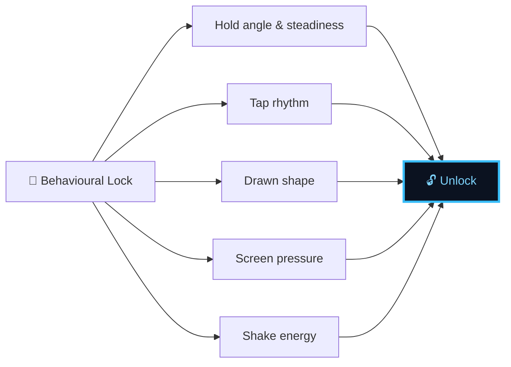

---

## Table of contents

| Section | What it covers |
|---|---|
| [Why not AI?](#why-not-ai) | The core design decision |
| [Architecture](#architecture) | Layers, modules and data flow |
| [How it works](#how-it-works) | Capture → segment → shape → score |
| [The setup flow](#the-setup-flow) | First launch, permissions, enrolment |
| [Multi-take enrolment](#multi-take-enrolment) | Why the routine is recorded three times |
| [The unlock flow](#the-unlock-flow) | What happens when the phone locks |
| [How matching works](#how-matching-works) | Scoring, thresholds, why they are what they are |
| [How the lock works](#how-the-lock-works) | Two modes, and the keyguard limitation |
| [The safety rule](#the-safety-rule) | Why the phone can never be bricked |
| [Project layout](#project-layout) | Every file and where to start reading |
| [Building](#building) | Build, test, install |
| [Privacy](#privacy) | What is measured and what is not |
| [Known limitations](#known-limitations) | Honest list of what does not work |

---

## Why not AI?

This system is **not machine learning**. It is **biometric signal processing**.

| | Measurement (this app) | Learning (machine learning) |
|---|---|---|
| What we have | A stored reference **+** a new sample | Only examples |
| What we do | Compute how close they are | Infer an unknown function |
| Data needed | One enrolment session | A large training set |

There is no public dataset for *your* grip and *your* tap rhythm. Collecting one
would take weeks and still be far too small. Worse, a model outputs one opaque
number — which would destroy the biggest design win here: the app can tell you
**exactly which factor did not match**.

So the scorer is deliberately plain. It compares your routine to the stored one
and reports each factor separately. Easier to debug, easier to explain, more
reliable.

---

## Architecture

The app is one Gradle module and one flat package, on purpose — it is meant to be
read top to bottom.

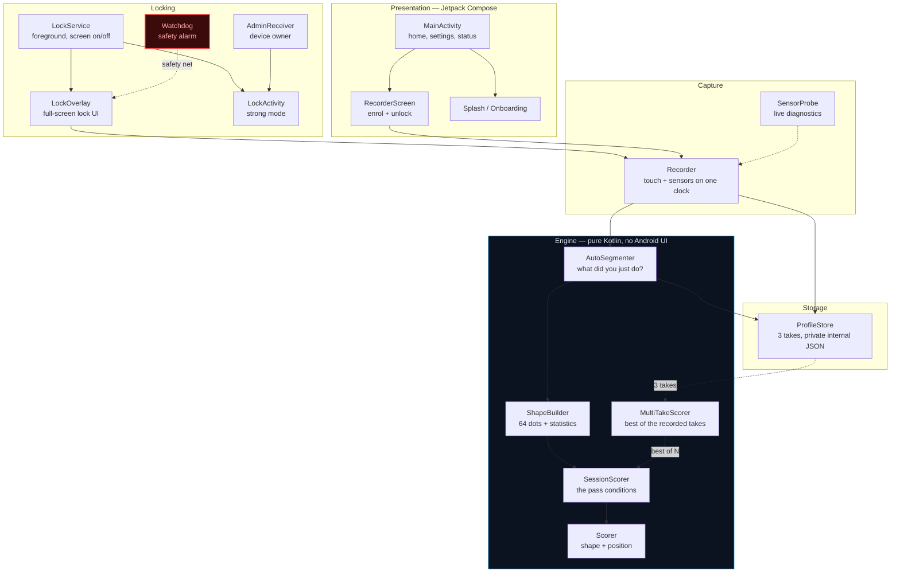

### Layer rules

| Layer | May depend on | Must never depend on |
|---|---|---|
| **Engine** (`AutoSegmenter`, `Shape`, `SessionScorer`, `Scorer`) | Plain data classes only | Android SDK, Compose, sensors |
| **Capture** (`Recorder`) | Android sensor APIs | UI state |
| **Locking** (`LockOverlay`, `LockService`, `Watchdog`) | Engine + capture | Compose (it is a raw `View` on purpose) |
| **Presentation** (`MainActivity`, `ui/`) | Everything | Sensor hardware |

The engine has **no Android imports at all**, which is why all 71 unit tests run
on a plain JVM in about a second with no device or emulator.

> `LockOverlay` deliberately builds its UI with raw `View`s instead of Compose.
> An overlay that renders is the difference between a lock and no lock, and the
> fewer moving parts it has, the more certain the behaviour.

---

## How it works

### 1. Capture — one clock for everything

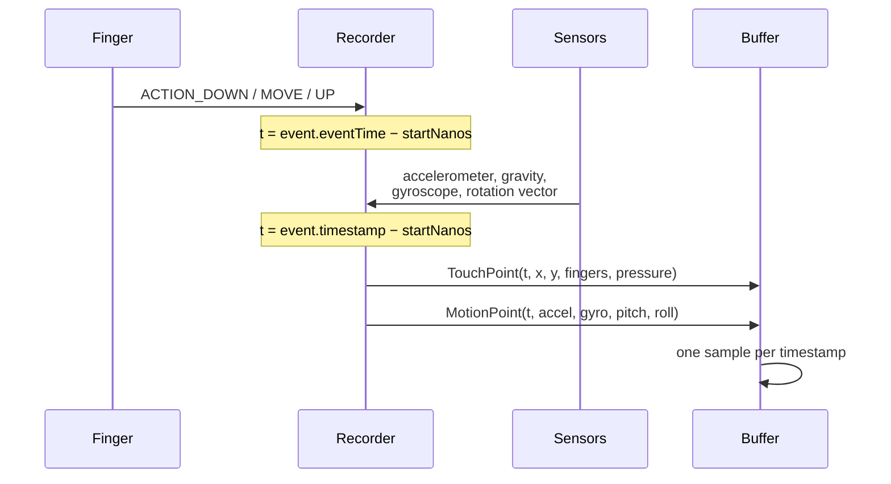

Touch and motion are recorded against **the same nanosecond clock**
(`SystemClock.elapsedRealtimeNanos()`). That is what makes it possible to ask
"did the phone move *when* the finger moved?" — which is how a shake is told
apart from a drag.

**One subtlety worth knowing about:** sensors in a batch share a timestamp, so
the recorder stores one sample per timestamp. Whichever sensor fires first
normally wins — and on most phones that is the accelerometer. If that happened
naively, the attitude carried by the rotation vector would be silently thrown
away and the phone would always report "held perfectly flat". The recorder folds
attitude into the stored sample instead of dropping it.

### 2. Auto-segmentation — the user declares nothing

There are **no menus and no segment types to choose**. The user presses one
button and performs the whole routine as one continuous recording. The app works
out what happened:

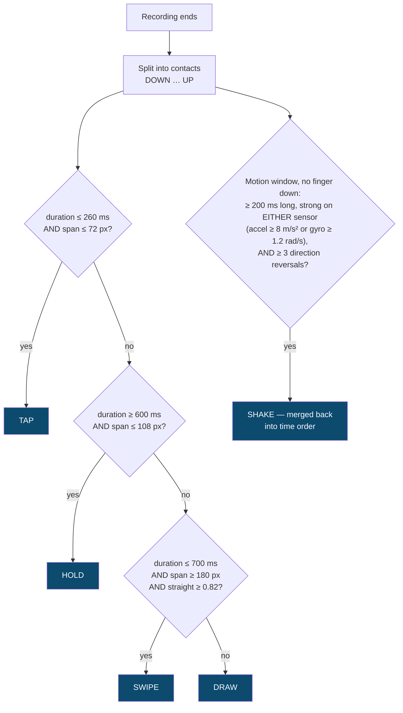

> **Span, not path.** "Did this go anywhere?" is measured as the straight-line
> distance between where the finger started and finished — *not* as total
> distance travelled. A finger resting on glass wobbles, and wobbling adds up a
> lot of path while going nowhere. Measuring path turned plain taps into
> "swipes" on a real device.

> **A shake oscillates; picking a phone up does not.** That is the whole shake
> rule. Lifting the phone off a desk is long, strong and *one-directional*, and
> it was being detected as the first action of the routine — every unlock failed
> with `expected Tap, got Shake`, but only while holding the phone. Requiring
> **three direction reversals** separates them. Two details matter: strength is
> judged on **either** sensor (a wrist-driven shake has big rotation rates and
> modest acceleration, and checking acceleration alone made it undetectable),
> and the axis is re-chosen **per sample**, because a real shake travels across
> all three axes and a single fixed axis only ever saw part of it.

The only thing a user has to learn:

> **Do your actions one after another, with a natural pause between them.**

Those pauses *are* the rhythm, and the rhythm is the strongest signal in the app.

### 3. Shape — everything shrinks to 64 dots

> *"Shrink both gestures down to 64 dots and measure how far apart the dots are."*

Raw traces are never compared: a fast swipe and a slow swipe produce completely
different point timings and would never match. Resampling by **arc length**
removes timing and scale; speed and rhythm are then scored separately.

Each `Shape` also carries the statistics the scorer needs:

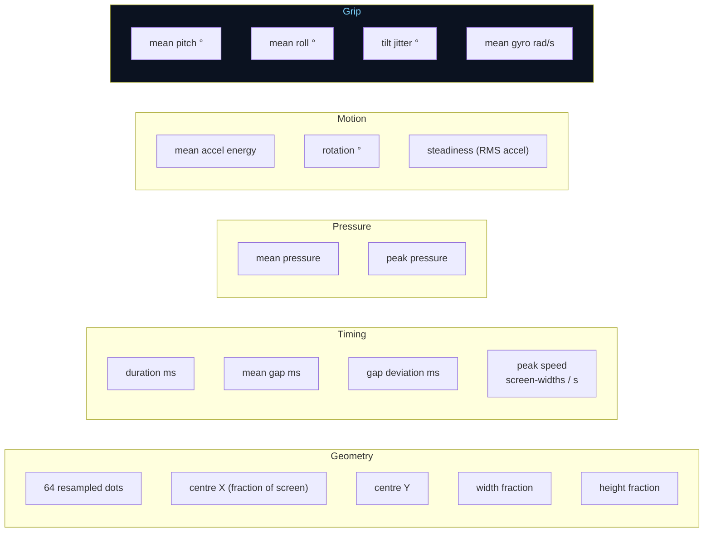

Normalising the dots alone would throw away *where* and *how big* the gesture
was, so an "M" drawn anywhere at any size would reduce to identical dots. Centre
and size are kept as fractions of the screen for exactly that reason.

### 4. Scoring — every factor, all explained

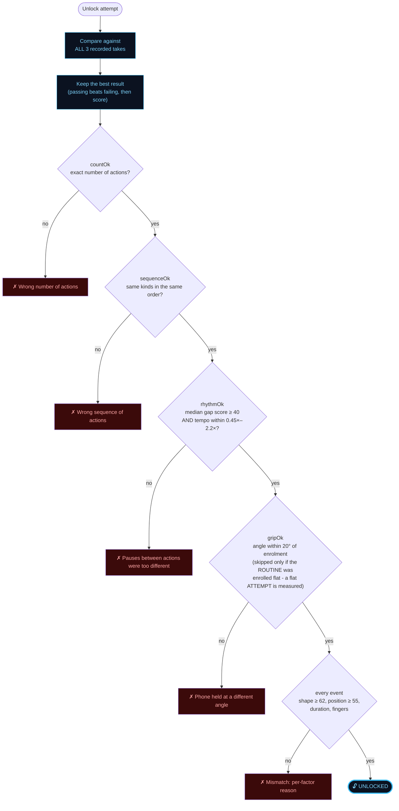

These are **pass conditions**, not decoration. Every one of them can refuse an
unlock, and each produces its own headline so the user knows what to fix.

The whole chain runs **three times** — once against each recorded take — and the
best result wins. See [Multi-take enrolment](#multi-take-enrolment).

---

## The setup flow

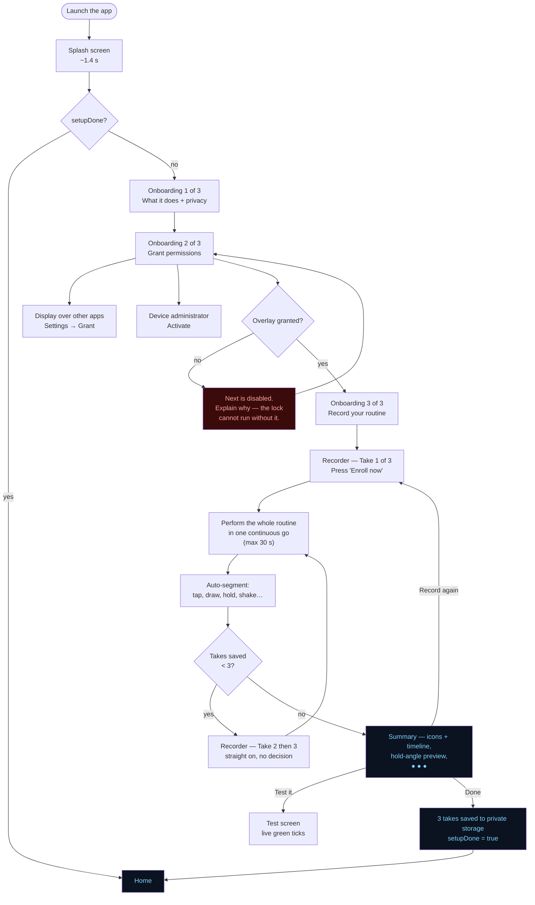

Three recordings are **mandatory** and chain automatically — there is no
decision between them and no way to stop at one and assume it is done.

### Steps, as a person experiences them

1. **Open the app.** A branded splash screen appears, then a three-step
   onboarding walkthrough the very first time.
2. **Step 1 — what it does.** One paragraph, plus a privacy card: no camera, no
   microphone, no network, no location. All four are never requested.
3. **Step 2 — grant two permissions.** Each row shows its **live** state, and a
   green tick appears the moment it is granted.
   - *Display over other apps* — lets the lock draw over the screen
   - *Device administrator* — lets the app lock the phone and recover it
   **Next stays disabled until the overlay permission is granted**, because the
   lock genuinely cannot run without it. "Skip for now" is always available and
   can never trap anyone.
4. **Step 3 — record a routine.** One button drops you straight into the recorder.
5. **Take 1.** Press **Enroll now**, then perform your whole routine as one
   continuous action — tap, draw, hold, shake, whatever you like. The app
   detects each action and drops a marker on it. Recording stops by itself after
   30 seconds, or early with **Stop**.
6. **Takes 2 and 3.** The app goes straight back to the recorder, labelled
   **Take 2 of 3**, and you perform the same routine again. There is nothing to
   decide between takes and no way to stop at one.

   If a take is rejected — most often *"That is a different routine"* — it says so
   plainly, because each take must be the same actions in the same order.
7. **Summary.** Every detected action is shown as an icon on a timeline, with the
   hold-angle preview and `● ● ●`. *Record again* starts over from a clean
   slate, *Test it* watches it match live.

   If the routine was recorded with the phone lying flat, the summary says so
   immediately and offers **Re-record while holding the phone** — a flat
   recording carries no information about how you hold the phone, so it cannot
   be recovered afterwards. Catching it here, rather than on the home screen
   days later, is the difference between a one-tap fix and a forgotten feature.
8. **Turn the lock on.** From the home screen.

> **Tip:** enrol while holding the phone the way you normally hold it. The
> grip factor records the angle, and it is skipped if you later unlock with the
> phone flat on a table.

---

## Multi-take enrolment

The routine is recorded **three times**, back to back, and an unlock attempt is
compared against all three. The best result wins.

### Why

One enrolment is **one arbitrary sample** of how you happened to behave on one
day. Demanding you reproduce it exactly is what produced the repeated
*"sometimes it works, sometimes it doesn't"*, and the only cure available at the
time was widening a tolerance until the owner stopped being rejected — which
quietly weakens the lock and is still guesswork.

Recording three times measures your **actual range** instead of guessing at it.
A genuine attempt is accepted if it resembles **any one** of them.

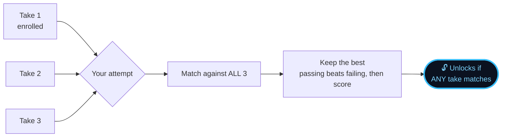

Exactly three, never fewer and never more. Fewer cannot show a range; more
widens what the lock accepts without adding meaningful reliability.

### How the best is chosen

Not simply "highest score". A **passing** result always beats a **failing** one,
however high the failure scored — otherwise a take that fails the exact-count
rule at 99% would outrank one that genuinely matches at 61%. There is a test
for exactly this.

### The honest cost

> This genuinely **lowers the bar**. An intruder needs to match **one of three**
> references rather than one of one. They still do not know any of them, so it
> is not a break — but it is a real reduction in margin, and it grows with the
> number of takes. That is why the count is fixed at three and not "as many as
> you like".

The same sentence is worth having ready if this is examined: *the same number of
takes that makes the owner reliably get in also makes an intruder marginally
more likely to.*

Every refusal records **how many takes matched**, so moving to a stricter
"2 of 3" rule is a decision made from data rather than taste.

### It cannot become a security loophole

Both were tested:

- **Extra actions still never unlock**, however many takes exist — every take
  has the same number of actions as the routine, so none can match an over-long
  attempt.
- **A genuinely wrong routine still fails** with three takes — the right count
  and tempo but the wrong hold is still refused.

### Backwards compatible

The first take is stored under the same key as before and is still written to
disk; the other two are purely additive. An existing saved routine cannot be lost,
and a profile written by any version of the app reads in any other. With a single
take, the best-of-N logic returns **exactly** what the old single-reference
comparison returned — there is a test asserting identical pass, score and headline.

---

## The unlock flow

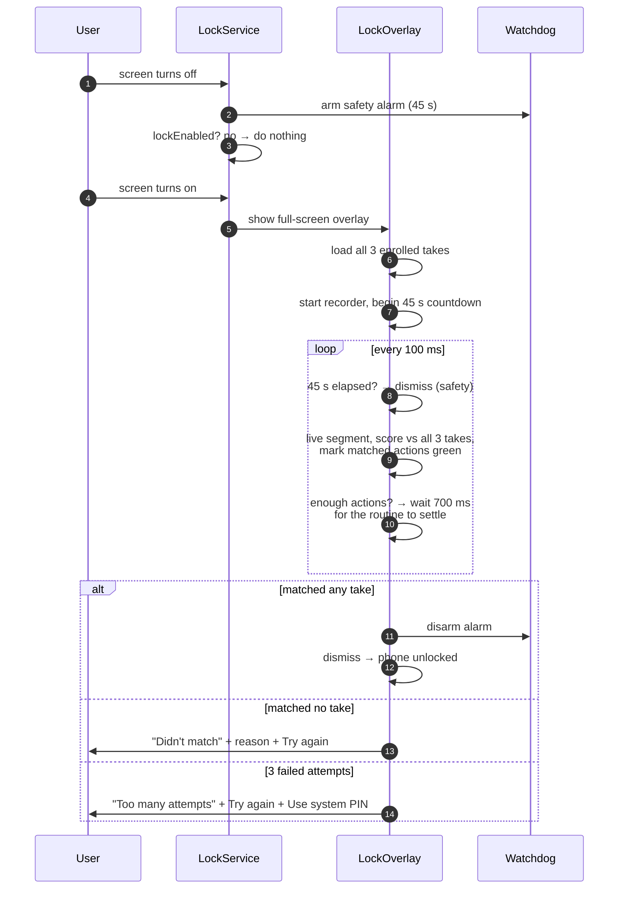

### The four safety guarantees

| Guarantee | Mechanism |
|---|---|
| Never bricks the phone | `Watchdog` alarm re-enables the system lock if the app dies |
| Never traps the user | The overlay **auto-releases after 45 seconds**, always |
| Never dead-ends | "Try again" is offered on *every* failure panel, including "Too many attempts" |
| Never a partial unlock | Exact count match — a prefix of the routine never opens it |

### The routine has to settle before it is judged

The lock does **not** judge the instant the expected number of actions has
arrived. It waits **700 ms** for the routine to stop changing first.

That matters more than it sounds. A finger that lifts even slightly splits one
tap into two contacts, which reaches the expected count early and judges a
half-finished routine. A routine ending in a long press then failed with
`expected Hold, got Tap`, purely because the judge ran while the press was
still resolving — and because it depended on exactly where a 100 ms poll landed
relative to the finger, it felt random rather than broken.

Waiting means the whole routine is always judged. Nothing is weakened by it:
extra actions arriving inside the settle window are still counted, the
exact-count rule still applies, and the 45-second release is unaffected.

### Getting it wrong quietly is the real enemy

Three separate bugs in this app shared one root cause: **a factor that was
doing nothing looked exactly like a factor that was working.** Attitude was
never assigned so grip was always skipped; a flat enrolment silently disabled
angle matching; a desk recording could never be matched by a hand.

Each is now stated in the interface rather than left to be discovered:

- the home screen shows a 3D drawing of the recorded hold, and says so plainly
  when the hold factor is not active, with a button to re-record
- the enrolment review screen catches a flat recording immediately, while it
  is still one tap from being fixed
- every refused attempt is written to `files/last-attempt.txt` with all of its
  numbers, so a failure can be read back afterwards instead of guessed at

---

## How matching works

Every gesture is reduced to **64 dots** and compared point by point, trying all
64 possible starting points and keeping the best match. That handles a signature
drawn from the top versus the bottom — 4096 comparisons, under a millisecond,
no rotation maths.

### Threshold decisions, and why

Real recordings forced almost every threshold in this app to change. These are
not arbitrary numbers.

**Tap duration does not block the match.**

An actual enrolment on a POCO M2 Pro produced tap hold-times of
`2, 3, 3, 10, 14, 15, 21, 22, 26 ms`. The touchscreen samples every ~20 ms, so
that number measures the *hardware*, not the person. With duration as a pass
condition, **7 unlock attempts out of 9 were refused** for `too fast or too
slow` — a 48 ms tap failing against an enrolled 12 ms tap.

Duration is now a pass condition only where duration *is* the gesture:

| Action | Duration blocks? | Why |
|---|---|---|
| **Hold** | yes | holding longer is the whole gesture |
| **Draw / Swipe / String** | yes | drawing slowly is characteristic |
| **Tap** | **no** | 2–30 ms is sampling noise |

It still counts towards the displayed score for every action. To compensate for
the lost signal, **tap position is now scored** (it previously was not counted
at all).

**Rhythm is robust, not millisecond-exact.**

The same enrolment had gaps of `238, 306, 1642, 248, 303, 1800, 271, 334 ms`,
all produced by one person in one go. Asking that person to land every one of
those inside ±44% next time is not a security control, it is a coin toss. So:

1. **Shared tolerance** — a gap may differ by 55% of its own length *or* 35% of
   the routine's median gap.
2. **Median, not mean** — the long pauses are hardest to repeat exactly; taking
   the median stops one or two missed pauses vetoing the whole routine.
3. **Tempo ratio** — overall pace must stay within **0.45×–2.2×**. This is where
   the security work actually happens.

**A flat phone means different things on each side of the comparison.**

This is the subtlest rule in the app, and it was wrong twice before it was
right. A phone lying flat on a desk reports pitch and roll near zero.

| Side | Flat means | Action |
|---|---|---|
| **Enrolment** | "no hold reference exists" | **skip.** Demanding the owner also unlock lying flat would mean putting the phone on a desk to open it — which nobody does. |
| **Attempt** | "the phone is on a table, not in a hand" | **measure it and refuse**, against a routine that was enrolled while held. |

Getting this wrong is expensive in both directions. Treating a *flat enrolment*
as a reference produced a deadlock: a phone on a desk has tilt jitter of 0.5°
(the physical minimum) while any phone in a hand measured 0.9–13.7°, so with a
1.5° tolerance floor the owner was rejected every single time they picked the
phone up. Treating a *flat attempt* as "unmeasurable" then let the factor be
bypassed entirely, so a held routine happily unlocked with the phone lying
face-up on a table.

Judged across the *whole routine*, because a single tap is shorter than the
motion sensor's sampling interval.

| Sub-factor | Tolerance | Blocks? |
|---|---|---|
| Angle (mean pitch/roll, circular mean) | ±20° | **yes** |
| Steadiness (tilt jitter) | ±60%, floor 4° | no — scored and reported |
| Mean gyro | — | no — reported |

Every one of those numbers came from **25 real unlock attempts** recorded on a
POCO M2 Pro, read back from the app's own failure report, not from guesswork.
The same person varied by up to 20° of tilt between attempts, which is why the
tolerance is 20° rather than the 15° first chosen — 15° sat *inside* the owner's
own noise. And steadiness cannot block because hand tremor while held
(0.9–13.7°) and while still (0.5–3.3°) overlap almost completely: it adds no
discrimination, only random rejections.

The app states on the home screen whether this factor is active at all, because
a routine enrolled flat silently disables it and that is indistinguishable from
a broken feature.

### Reliability by shape

| Shape | Reliability |
|---|---|
| Circle, cross, triangle, star, arrow | Excellent |
| Multi-stroke shapes | Very good |
| Your signature | Works, but the weakest case — signatures drift over time |

### Factors the phone cannot measure are skipped, never failed

Since Android 13 most phones report a **constant** pressure value. The app
detects this, marks pressure `SKIPPED`, and re-weights the rest. The feature is
never silently wrong.

---

## How the lock works — two modes

### Compatible mode — works on every phone

The app draws a **full-screen overlay** on top of whatever is showing, swallows
every touch, and removes itself the moment the routine matches.

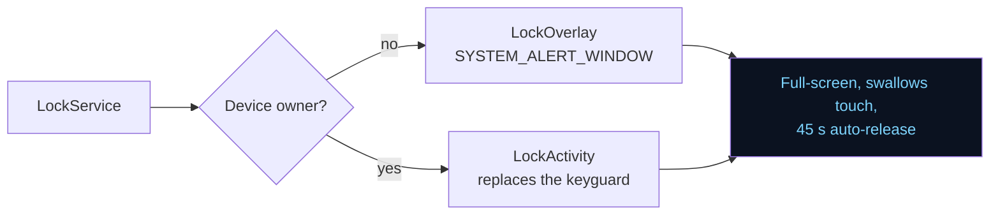

> **Why not just replace the lock screen?** Android does not let a third-party
> app dismiss the system keyguard unless it is a device owner. An early version
> of this app tried `lockNow()` with `showWhenLocked` and ended up showing a
> screen nobody could get past — discovered by testing on a real phone. The
> overlay sidesteps the restriction, and is the same technique every app-lock
> product on the Play Store uses.

Needs one permission: **Display over other apps**. The lock refuses to run
without it, and the app tells you so on the home screen and in a notification.

### Strong mode — optional, one-time USB setup

The app becomes a **device owner**, which lets it disable the system keyguard
entirely and be the only lock. Most phones will refuse it.

```powershell
.\scripts\provision-device-owner.ps1
```

> Strong mode also disables fingerprint and face unlock, because those require
> the system keyguard to stay active.

---

## The safety rule

> **Never disable the system keyguard without arming the safety alarm first.**

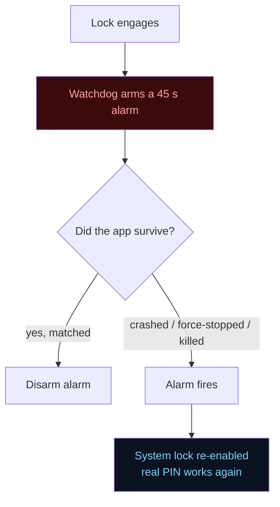

**The phone cannot be bricked by this app.** This is enforced in code at every
call site, not just documented.

---

## Project layout

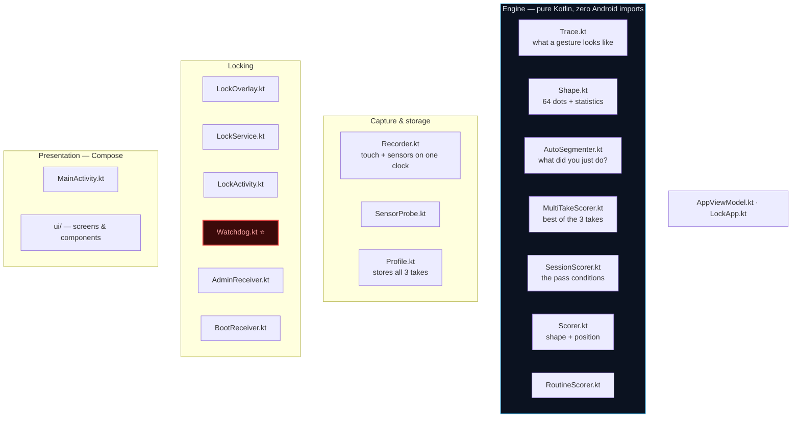

```
app/src/main/java/com/block/behaviortlock/
├── Trace.kt            what a recorded gesture looks like
├── Shape.kt            reduces a gesture to 64 dots + statistics
├── AutoSegmenter.kt    works out what you did, without you declaring it
├── SessionScorer.kt    compares one attempt against one reference
├── MultiTakeScorer.kt  compares it against all 3 takes, keeps the best
├── Scorer.kt           shape matching and factor scoring
├── RoutineScorer.kt    per-action helper scoring
├── Recorder.kt         records sensors AND touches on one clock
├── SensorProbe.kt      live sensor feed for Diagnostics
├── Profile.kt          saves/loads the enrolled routine (all 3 takes)
├── AppViewModel.kt     single source of truth for the UI
├── AdminReceiver.kt    device-admin permission + the two lock modes
├── Watchdog.kt         the safety net (most important file)
├── LockService.kt      keeps the app alive, catches screen on/off
├── LockOverlay.kt      the actual lock
├── LockActivity.kt     the lock screen for strong mode
├── LockApp.kt          app startup
├── BootReceiver.kt     re-arms the lock after a reboot
├── MainActivity.kt     home + settings + status screens
└── ui/                 Compose screens and shared components
```

### Where to start reading

| If you want to understand… | Read |
|---|---|
| What a gesture looks like | `Trace.kt` |
| How it knows what you did | `AutoSegmenter.kt` |
| How matching works | `Shape.kt`, then `SessionScorer.kt` |
| Why 3 recordings are compared | `MultiTakeScorer.kt` |
| How data is captured | `Recorder.kt` |
| Why the phone can't get locked out | `Watchdog.kt` |
| The screens | `MainActivity.kt`, then `ui/` |

---

## Building

Requires Android Studio (Ladybug or newer) with JDK 17+.

| Setting | Value |
|---|---|
| Gradle / AGP | 9.x |
| Kotlin | 2.4.x *(built into AGP 9 — do **not** apply `kotlin.android`)* |
| `compileSdk` / `targetSdk` | 37 / 35 |
| `minSdk` | 29 (Android 10) |
| Tests | 71 unit tests, plain JVM, no device needed |

```bash
# Unit tests — the whole engine, in about a second
.\gradlew.bat :app:testDebugUnitTest

# Debug build
.\gradlew.bat :app:assembleDebug

# Output
app\build\outputs\apk\debug\app-debug.apk

# Install on a connected phone
adb install -r app\build\outputs\apk\debug\app-debug.apk
```

> **Xiaomi / MIUI note:** MIUI resets the *Display over other apps* permission to
> `ignore` every time an app is reinstalled. Grant it again after each install —
> the app's home screen tells you when it is missing.

### Strong mode setup (optional)

```powershell
.\scripts\provision-device-owner.ps1
```

---

## Privacy

The app requests **no** camera, microphone, location, contacts, network or
Bluetooth permission. It reads only motion sensors and the gesture you perform
on your own lock screen.

Sensors run **only during a gesture**, not continuously — roughly 3–4 mA during
an unlock, and the app never passively profiles how you hold your phone.

### Storage note

Enrolled templates are stored in the app's **private internal storage**, which
Android sandboxes so no other app can read it. They are *not* encrypted at rest:
a rooted attacker with physical access could read the file. The upgrade path is
Android Keystore-backed encryption (`androidx.security-crypto`). This is a
deliberate trade-off — simpler to audit, and the threat it does not cover is
already covered by the phone's own disk encryption.

---

## Known limitations

- **Force-stop kills the service.** No Android app can survive this; the
  watchdog recovers the phone.
- **After a reboot** Android always shows the real PIN once before third-party
  locks take over. Expected, and a security feature.
- **Grip is inactive for a routine enrolled flat.** If you record while the phone
  is lying on a desk, there is no hold reference and the angle is not checked.
  The home screen says so in red.
- **Signatures drift** over time; re-enrol every ~6 months.
- **Long identical tap runs are the hardest routine.** Nine identical taps have
  no shape or position anchor, so rhythm carries almost the whole load. A routine
  with a drawn shape or a hold matches far more reliably.
- **MIUI (Xiaomi)** aggressively kills background apps, which is why the lock
  runs as a foreground service.
- **Three takes widen what the lock accepts.** Matching the best of three
  recordings is more forgiving than matching one — which is the point — but it
  genuinely lowers the bar. See [Multi-take enrolment](#multi-take-enrolment).